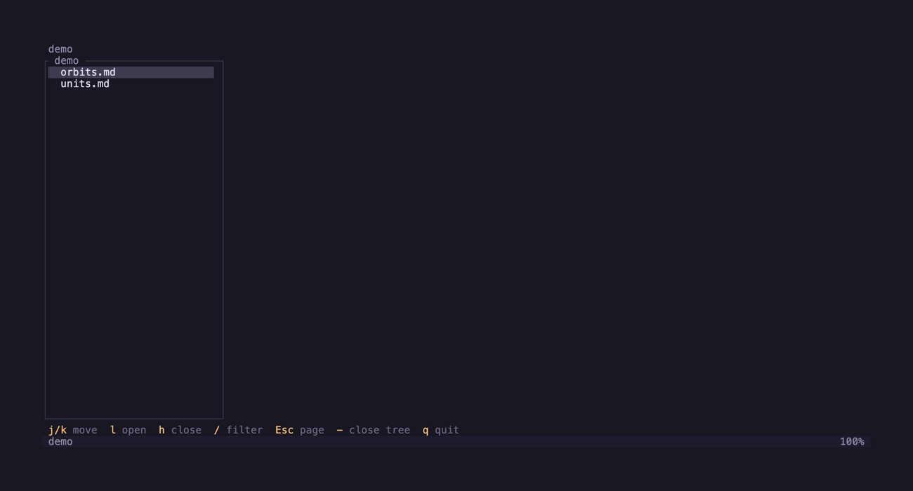

# 🪞 mdlive

A Markdown preview for the terminal. Open a file, or a folder of them, and read it the way a docs site shows it: headings, tables, code in colour, maths, diagrams and pictures. Save the file in your editor and the page draws again, at the same place.



## Install

On macOS, with Homebrew:

```sh
brew install gf6599/tap/mdlive
```

Each [release](https://github.com/GF6599/mdlive/releases) also carries archives for macOS and Linux, on Intel and ARM. The Linux binaries are static, so they run on any distribution.

From a clone, with the current stable Rust toolchain (1.99 builds it):

```sh
cargo install --path . --locked
```

## Usage

```sh
mdlive README.md    # read one file
mdlive docs         # pick a file from the tree of a folder
mdlive              # the tree of the current folder
```

The bar at the bottom names the keys for what you are doing, and `g?` lists every key. These are the ones to learn first:

| Key | Action |
|---|---|
| `j` / `k`, `C-d` / `C-u` | Scroll a line, or half a page |
| `gg` / `G` | Go to the top or the end. A count first, such as `12G`, goes to that line of the file |
| `]]` / `[[` | Next or previous section |
| `t` | Open or close the contents. With it open, the letter beside a section goes there |
| `-` | Open the file tree: every Markdown file of the git repository, or of the file's folder outside one |
| `/`, `n` / `N` | Search, then the next or previous match |
| `]l`, `Enter` | Mark the next link, then follow it. `C-o` goes back |
| `]p`, `Enter` | Mark the next picture, then open it on the whole screen. There `+` / `-` zoom, `h` `j` `k` `l` pan, `0` fits it again and `q` closes it |
| `za` | Open or close a fold, a `<details>` block |
| `V`, `y` | Select whole lines, then copy their Markdown source |
| `E` | Edit the file at the line at the top of the screen, in `$VISUAL` or `$EDITOR` |
| `q` | Quit |

The mouse works too: the wheel scrolls, a click picks a contents entry, a tree row or a link, a click on a picture opens it on the whole screen, and a drag selects lines and copies them when you let go.

### What a page shows

- **Live reload.** mdlive watches the file and draws it again on each save, under the same heading.
- **Links.** A link to another page opens it in mdlive, and a `#heading` link jumps to that heading. A web or mail link opens in the browser. A link with any other scheme stays closed, because link text can hide where it goes.
- **Copy.** `y` puts the selected source on the clipboard: through `pbcopy` on macOS, and through an OSC 52 code elsewhere, which the terminal must allow.
- **Maths.** `$…$` and `$$…$$` show as Unicode text. A matrix or a `cases` block takes one row per line, with its columns aligned.
- **Diagrams.** A Mermaid block shows as a picture in a terminal that draws pictures, and as box text in one that does not.
- **Pictures.** A terminal with the Kitty, iTerm2 or Sixel picture protocol, such as Ghostty, kitty, WezTerm or iTerm2, draws them in full. Other terminals draw them in half blocks. A picture from the web is never fetched, so opening a page makes no network call.

### Where pictures come from

A relative path, such as `img/plot.png` or `../shared/plot.png`, starts at the folder of the Markdown file.

A path from the root, such as `/diagrams/plot.svg`, is found the way a docs site serves it. mdlive first tries the path as it stands on disk. Then it looks in `public/`, in `static/` and in the folder itself, starting at the folder of the page and going up one folder at a time. It stops at the root of the git repository, so it never takes a picture from another project.

## Development

```sh
just          # list every recipe
just tools    # install cargo-deny once, at the version the gate uses
just check    # the quality gate: clippy, the tests, cargo deny, then a format check
just demo     # record doc/demo.gif with vhs
```

## License

MIT.
